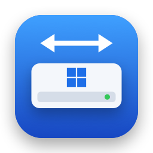

<div align="center">



# NTFS for Mac

**Read and write Windows (NTFS) drives right in Finder — free and open source.**

[](https://github.com/dovancuongadhp/ntfs-for-mac/releases/latest)
[](https://github.com/dovancuongadhp/ntfs-for-mac/releases)
[](#requirements)
[](LICENSE)

[**⬇ Download NTFS-for-Mac.dmg**](https://github.com/dovancuongadhp/ntfs-for-mac/releases/latest/download/NTFS-for-Mac.dmg)
· [What's new](https://github.com/dovancuongadhp/ntfs-for-mac/releases)
· [**Tiếng Việt**](README.vi.md)

</div>

---

Your Mac can read Windows (NTFS) drives, but it can't write to them. NTFS for Mac fixes that: plug in a USB
stick, an external disk or a Boot Camp partition formatted by Windows, and copy, rename, delete and organize
files in Finder like on any other drive.

Nothing to configure, no restart, no extra software to install: drag the app to Applications, switch it on
once, and you're done.

## Contents

- [What it does](#what-it-does)
- [Requirements](#requirements)
- [Install](#install)
- [Everyday use](#everyday-use)
- [Formatting a drive](#formatting-a-drive)
- [File Transfer (beta)](#file-transfer-beta)
- [When a drive opens read-only](#when-a-drive-opens-read-only)
- [What it can't do yet](#what-it-cant-do-yet)
- [Updating and uninstalling](#updating-and-uninstalling)
- [Questions](#questions)
- [Reporting a problem](#reporting-a-problem)

## What it does

- **Write to NTFS drives in Finder** — copy, move, rename, delete and create folders, just like on a Mac drive.
- **Lives in the menu bar** — see your drives, how full they are and whether they can be written to; open,
  mount or eject them in one click. Keep any drive read-only if you prefer.
- **Manages and formats drives** — a window like Disk Utility shows every drive and its partitions, and formats
  a partition or a whole external drive as NTFS, exFAT, FAT32 or APFS. Your Mac's own drives are protected.
- **Protects your data** — when writing could damage the drive (for example Windows is hibernated, or the
  drive was unplugged without ejecting), the drive opens read-only and the app tells you how to fix it.
- **No `._` files** — Finder tags and other Mac information are kept inside the drive, so Windows doesn't see
  stray `._` files.
- **English and Vietnamese** — follows your Mac's language, or choose one in Settings.
- **Free** — no trial, no subscription, no ads, no data collection.

## Requirements

- **macOS 26 (Tahoe) or later.**
- Any Mac, with Apple silicon or Intel.

## Install

1. **Download** [`NTFS-for-Mac.dmg`](https://github.com/dovancuongadhp/ntfs-for-mac/releases/latest/download/NTFS-for-Mac.dmg)
   and open it.
2. **Drag NTFS for Mac into the Applications folder.**
3. **Open the app.** The app isn't notarized by Apple yet, so the first time macOS blocks it:
   1. Click **Done** in the warning.
   2. Open **System Settings → Privacy & Security**, scroll down and click **Open Anyway**.

   Or, if you're comfortable with Terminal, run this once:

   ```sh
   xattr -dr com.apple.quarantine "/Applications/NTFS for Mac.app"
   ```
4. **Switch it on.** The app shows whether NTFS for Mac is turned on, with a button that opens the right place in
   System Settings: **General → Login Items & Extensions → File System Extensions**. Turn on **NTFS for Mac**.
5. **Plug in your drive.** It appears in Finder, ready to write. If it was already plugged in, click **Mount**
   next to it in the menu bar.

## Everyday use

NTFS for Mac sits in the menu bar (it has no Dock icon). Click its icon to see your NTFS drives:

| You see | What it's for |
| --- | --- |
| Status | **Read & write**, **Read-only — reason**, **Not mounted**… |
| Bar | How full the drive is |
| **Allow writing** | Turn off to keep this drive read-only. Remembered for each drive |
| Folder button | Open the drive in Finder |
| **Mount** | Use a drive that is plugged in but not mounted |
| Eject button | Eject the drive safely |

**Open NTFS for Mac…** opens the main window, with every drive in the sidebar and a page for each.
**Settings…** lets you start the app when you log in, choose the language, and check that NTFS for Mac is turned on.

> [!IMPORTANT]
> Always **eject** a drive (in Finder or from the menu bar) before unplugging it, so all your changes are saved to it.

## Formatting a drive

In the main window, select a partition, or a whole drive, and click **Format…**. You can choose NTFS, exFAT,
FAT32 or APFS; when erasing a whole drive, also GPT or MBR.

> [!WARNING]
> Formatting erases everything on the partition or drive. Copy what you need first.

The app takes care not to erase the wrong thing:

- It lists exactly what will be erased, and you type the drive's name to confirm.
- If the drive is unplugged or changed in the meantime, it stops and erases nothing.
- Your Mac's internal drives and the drive macOS runs from can't be formatted.
- Formatting as NTFS asks for your Mac password in the usual macOS dialog. The app never sees it.

## File Transfer (beta)

New in 2.2.0, the **File Transfer** page in the main window has two file browsers side by side for copying
between any drives and folders: drag from one side to the other, or copy and paste. A progress list shows
every copy and file, with pause and resume, retry of failed files, and a choice when a file or folder already
exists. The list is kept until you press **Clear**. The feature is a beta: try it with files you have a backup of.

## When a drive opens read-only

NTFS for Mac never writes to a drive that might not be in a safe state. When a drive shows **Read-only**, the
reason is shown next to it:

| Status | Why | What to do |
| --- | --- | --- |
| Windows is hibernated | Windows is hibernated or uses Fast Startup and still holds the drive | Start Windows, hold **Shift** while clicking **Shut Down** (or turn off Fast Startup), then plug the drive in again |
| Not ejected safely | The drive was unplugged without ejecting, or Windows didn't shut down properly | Plug it into Windows and shut down normally, or click **Allow Writing Anyway…** (changes Windows didn't finish saving may be lost) |
| Disk needs checking | Windows asked for the drive to be checked | Run `chkdsk /f` on the drive in Windows, then plug it in again |
| Disk is write-protected | The drive or card has its lock switch on | Slide the lock switch off |
| Write error | Writing failed, so it was stopped to protect your files | Eject the drive and check the cable or the drive |
| Writing turned off | You turned off **Allow writing** for this drive | Turn **Allow writing** back on |
| Read-only (macOS driver) | NTFS for Mac isn't turned on | Turn it on (step 4 of [Install](#install)) |

## What it can't do yet

- Resize, add or delete partitions (it can format a partition or erase a whole drive).
- Repair a damaged drive (use `chkdsk` in Windows).
- Change Windows file permissions.
- Open BitLocker-encrypted drives or EFS-encrypted files.

## Updating and uninstalling

**Updating:** NTFS for Mac checks for new versions in **Settings**. You can also download the new DMG and drag
the app into Applications, replacing the old one.

**Uninstalling:** quit the app (menu → **Quit**) and drag **NTFS for Mac** from Applications to the Trash.
Only a few small settings files are left behind.

## Questions

<details>
<summary><b>Is it safe to write to my drive?</b></summary>

Reading and writing NTFS is done by [ntfs-3g](https://github.com/tuxera/ntfs-3g), used on Linux for well over
a decade, and NTFS for Mac refuses to write whenever the drive isn't in a clean state (see
[When a drive opens read-only](#when-a-drive-opens-read-only)). As with any disk tool, keep a backup of
important files and always eject before unplugging.
</details>

<details>
<summary><b>Do I need macFUSE, a kernel extension, or to turn off System Integrity Protection?</b></summary>

No. NTFS for Mac uses Apple's own system for adding file systems (FSKit). Everything stays inside the app.
</details>

<details>
<summary><b>Why does macOS say the app can't be opened?</b></summary>

The app isn't notarized by Apple yet. Follow step 3 of [Install](#install) once; after that it opens normally.
</details>

<details>
<summary><b>Does it work on macOS 15 Sequoia or earlier?</b></summary>

No. It needs macOS 26 or later.
</details>

<details>
<summary><b>My drive doesn't appear, or shows "Not supported".</b></summary>

The menu bar lists NTFS drives only, so check the drive's format in the main window first. **Not supported —
encrypted (BitLocker) or damaged** means the drive is BitLocker-encrypted (turn BitLocker off in Windows) or
damaged (run `chkdsk /f` on it in Windows).
</details>

<details>
<summary><b>Is it really free?</b></summary>

Yes. It's open-source software under the GNU GPL v2 or later: no trial, no ads, no data collection.
</details>

## Reporting a problem

Please [open an issue](https://github.com/dovancuongadhp/ntfs-for-mac/issues/new) and tell us:

- your macOS version and Mac model,
- the NTFS for Mac version (**Settings → About**),
- what you did, what you expected and what happened instead.

If you can, also paste what this Terminal command prints, run right after the problem happens:

```sh
log show --last 10m --predicate 'subsystem BEGINSWITH "com.docuong.ntfsformac"'
```

---

NTFS for Mac is free software under the [GNU General Public License v2.0 or later](LICENSE), built on
[ntfs-3g](https://github.com/tuxera/ntfs-3g). Developers: see [CONTRIBUTING.md](CONTRIBUTING.md) to build it and
take part.

NTFS, Windows and BitLocker are trademarks of Microsoft Corporation. macOS and Finder are trademarks of Apple Inc.
This project is not affiliated with or endorsed by Microsoft or Apple.
