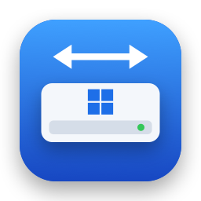

<div align="center">



# NTFS for Mac

**Đọc và ghi ổ Windows (NTFS) ngay trong Finder — miễn phí, mã nguồn mở.**

[](https://github.com/dovancuongadhp/ntfs-for-mac/releases/latest)
[](https://github.com/dovancuongadhp/ntfs-for-mac/releases)
[](#yêu-cầu-hệ-thống)
[](LICENSE)

[**⬇ Tải NTFS-for-Mac.dmg**](https://github.com/dovancuongadhp/ntfs-for-mac/releases/latest/download/NTFS-for-Mac.dmg)
· [Ghi chú phát hành](https://github.com/dovancuongadhp/ntfs-for-mac/releases)
· [Nhật ký thay đổi](CHANGELOG.md)
· [**English**](README.md)

</div>

---

macOS đọc được ổ NTFS nhưng không ghi được. NTFS for Mac giải quyết chuyện đó: cắm USB, ổ cứng di động hay
phân vùng Boot Camp do Windows định dạng vào là có thể sao chép, đổi tên, xoá và sắp xếp tệp trong Finder như
mọi ổ đĩa khác.

Ứng dụng chạy dưới dạng **tiện ích mở rộng hệ thống tệp FSKit** của Apple, nằm sẵn trong app. Không cần kernel
extension, không cần macFUSE, không phải tắt SIP và không phải khởi động lại máy. Cài đặt: kéo app vào
Applications. Gỡ bỏ: kéo app vào Thùng rác.

## Mục lục

- [Tính năng](#tính-năng)
- [Yêu cầu hệ thống](#yêu-cầu-hệ-thống)
- [Cài đặt](#cài-đặt)
- [Cách sử dụng](#cách-sử-dụng)
- [Quản lý ổ và định dạng](#quản-lý-ổ-và-định-dạng)
- [Khi ổ chỉ mở ở chế độ chỉ đọc](#khi-ổ-chỉ-mở-ở-chế-độ-chỉ-đọc)
- [Giới hạn](#giới-hạn)
- [Gỡ bỏ](#gỡ-bỏ)
- [Câu hỏi thường gặp](#câu-hỏi-thường-gặp)
- [Phiên bản](#phiên-bản)
- [Báo lỗi](#báo-lỗi)
- [Cách hoạt động](#cách-hoạt-động)
- [Tự build từ mã nguồn](#tự-build-từ-mã-nguồn)
- [Đóng góp](#đóng-góp)
- [Lời cảm ơn](#lời-cảm-ơn)
- [Giấy phép](#giấy-phép)

## Tính năng

- **Ghi được ngay trong Finder** — ổ NTFS được tự động gắn ở chế độ đọc và ghi, dùng như ổ bình thường:
  sao chép, di chuyển, đổi tên, xoá, tạo thư mục.
- **Biểu tượng trên thanh menu** — xem mọi ổ NTFS đang cắm cùng trạng thái và dung lượng đã dùng; gắn, đẩy ra
  hoặc mở ổ trong Finder; tắt ghi cho ổ nào bạn muốn giữ ở chế độ chỉ đọc.
- **Quản lý ổ** — cửa sổ theo phong cách Disk Utility hiển thị mọi ổ đang cắm cùng các phân vùng, và định dạng một
  phân vùng hoặc cả ổ ngoài thành NTFS, exFAT, FAT32 hay APFS. Ổ trong máy và ổ chứa macOS được bảo vệ.
- **Bảo vệ dữ liệu** — khi ghi có thể gây hỏng dữ liệu (Windows đang ngủ đông, ổ chưa được đẩy ra an toàn,
  Windows yêu cầu kiểm tra ổ, hoặc có lỗi ghi), ổ sẽ được mở ở chế độ chỉ đọc kèm lý do và cách khắc phục.
- **Không sinh tệp `._` rác** — thuộc tính mở rộng của macOS (thẻ Finder, nguồn tải về, Finder info…) được lưu
  thẳng vào NTFS dưới dạng alternate data stream.
- **Gọn nhẹ, chạy bằng công nghệ gốc của Apple** — tiện ích FSKit chạy ở chế độ người dùng, lõi NTFS là thư viện
  [ntfs-3g](https://github.com/tuxera/ntfs-3g) đã được kiểm chứng nhiều năm.
- **Tiếng Việt và tiếng Anh** — theo ngôn ngữ hệ thống, hoặc tự chọn trong Cài đặt.
- **Miễn phí, mã nguồn mở** — giấy phép GPL-2.0-or-later, không dùng thử, không thuê bao, không thu thập dữ liệu.

## Yêu cầu hệ thống

- **macOS 26 (Tahoe) trở lên.** FSKit trên các bản macOS cũ hơn chưa có đủ API để ghi nhanh và ổn định.
- Mac dùng chip Apple silicon hoặc Intel.

## Cài đặt

1. **Tải** [`NTFS-for-Mac.dmg`](https://github.com/dovancuongadhp/ntfs-for-mac/releases/latest/download/NTFS-for-Mac.dmg)
   rồi mở ra.
2. **Kéo NTFS for Mac vào thư mục Applications.**
3. **Mở ứng dụng.** Bản hiện tại **chưa được Apple công chứng (notarize)** nên lần mở đầu tiên macOS sẽ chặn:
   1. Bấm **Xong** trong hộp thoại cảnh báo.
   2. Mở **Cài đặt hệ thống → Quyền riêng tư & Bảo mật**, kéo xuống dưới và bấm **Vẫn mở**.

   Hoặc chạy lệnh sau một lần trong Terminal:

   ```sh
   xattr -dr com.apple.quarantine "/Applications/NTFS for Mac.app"
   ```
4. **Bật tiện ích mở rộng hệ thống tệp.** Lần mở đầu tiên, ứng dụng hiện trang **Cài đặt**, có nút
   **Mở Cài đặt hệ thống** đưa bạn tới
   **Cài đặt chung → Mục đăng nhập & tiện ích mở rộng → Tiện ích mở rộng hệ thống tệp**. Bật **NTFS for Mac**.
5. **Cắm ổ NTFS.** Ổ hiện trong Finder và ghi được ngay. Nếu ổ đã cắm từ trước, bấm **Gắn** cạnh tên ổ trên
   thanh menu.

> [!TIP]
> Muốn cập nhật, tải DMG mới rồi kéo app vào Applications, chọn thay thế bản cũ. Bạn không cần bật lại tiện
> ích mở rộng, miễn là bản mới được ký giống bản cũ.

## Cách sử dụng

NTFS for Mac nằm trên thanh menu (không hiện trên Dock). Bấm vào biểu tượng — chuột trái hay chuột phải đều
được — để xem các ổ NTFS. Mỗi ổ hiển thị:

| Mục | Ý nghĩa |
| --- | --- |
| Trạng thái | **Đọc và ghi**, **Chỉ đọc — lý do**, **Chưa gắn**… |
| Thanh dung lượng | Dung lượng đã dùng, cập nhật liên tục khi menu đang mở |
| **Cho phép ghi** | Tắt để giữ ổ ở chế độ chỉ đọc. Lựa chọn được ghi nhớ riêng cho từng ổ |
| Nút thư mục | Mở ổ trong Finder |
| **Gắn** | Gắn ổ đang cắm nhưng chưa được gắn |
| Nút đẩy ra | Đẩy ổ ra an toàn |

Trong menu còn có **Mở NTFS for Mac…** để mở [cửa sổ chính](#quản-lý-ổ-và-định-dạng). **Cài đặt…** mở cửa sổ
ở trang **Cài đặt** (cũng nằm cuối thanh bên), nơi bạn có thể:

- bật **Mở NTFS for Mac khi đăng nhập**,
- chọn **Ngôn ngữ** (Theo hệ thống, English, Tiếng Việt),
- kiểm tra tiện ích mở rộng hệ thống tệp đã bật hay chưa.

> [!IMPORTANT]
> Luôn **đẩy ổ ra** (trong Finder hoặc trên thanh menu) trước khi rút, để mọi thay đổi được ghi hết vào ổ.

## Quản lý ổ và định dạng

Chọn **Mở NTFS for Mac…** trên thanh menu để mở cửa sổ chính. Thanh bên liệt kê mọi ổ đang cắm, chia thành
**Ổ ngoài** và **Trong máy**, kèm các phân vùng bên dưới. Chọn một phân vùng để xem định dạng, dung lượng đã dùng
và trạng thái NTFS; chọn một ổ để xem model, kiểu kết nối, bảng phân vùng và bản đồ phân vùng. Thanh công cụ có
**Gắn**/**Tháo**, **Đẩy ra**, **Hiện trong Finder** và **Định dạng…**, dùng được cho mọi ổ, không chỉ ổ NTFS.

**Định dạng…** xoá phân vùng đang chọn, hoặc xoá toàn bộ ổ khi bạn chọn chính ổ đó:

| Tùy chọn | Lựa chọn |
| --- | --- |
| Định dạng | NTFS, exFAT, FAT32, APFS |
| Bảng phân vùng (chỉ khi xoá cả ổ) | GUID (GPT) hoặc Master Boot Record (MBR) |
| Tùy chọn NTFS | Kích thước cụm (Tự động phù hợp với hầu hết ổ; cụm lớn hơn lãng phí chỗ khi có nhiều tệp nhỏ); **Định dạng nhanh** (tắt đi để ghi số 0 lên toàn bộ phân vùng, mất nhiều thời gian hơn) |

Việc định dạng được thiết kế để không bao giờ xoá nhầm:

- Hộp thoại liệt kê chính xác phần nào sẽ bị xoá và phần nào không, và bạn phải gõ tên ổ để xác nhận.
- Ổ được kiểm tra lại ngay trước mỗi bước. Nếu ổ bị rút ra, bị thay bằng ổ khác hoặc đã thay đổi, việc định dạng
  dừng lại và không có gì bị xoá.
- **Ổ trong máy, ổ chứa macOS đang chạy và ổ chứa NTFS for Mac được bảo vệ.** Các ổ này vẫn hiển thị nhưng không
  thể tháo, đẩy ra hay định dạng. Ảnh đĩa cũng không thể định dạng.
- Định dạng NTFS chạy một công cụ nhỏ với quyền quản trị viên, bạn cấp trong hộp thoại mật khẩu chuẩn của macOS.
  NTFS for Mac không bao giờ thấy mật khẩu của bạn. Lần đầu, macOS cũng có thể hỏi quyền truy cập ổ rời.
- Xoá **toàn bộ ổ** thành NTFS gồm hai bước: macOS xoá ổ thành exFAT trước, rồi hỏi mật khẩu để chuyển phân vùng
  sang NTFS. Nếu bạn hủy hộp thoại đó, ổ vẫn là exFAT.
- Khi định dạng một phân vùng Mac (APFS hoặc Mac OS Extended) thành NTFS, loại phân vùng cũng được đổi để Windows
  nhận ra.

## Khi ổ chỉ mở ở chế độ chỉ đọc

NTFS for Mac không bao giờ ép ghi vào ổ đang ở trạng thái có thể không nhất quán. Khi ổ hiện **Chỉ đọc**, lý do
được ghi ngay bên cạnh:

| Trạng thái | Nguyên nhân | Cách xử lý |
| --- | --- | --- |
| Windows đang ngủ đông | Windows đang ngủ đông hoặc bật Khởi động nhanh (Fast Startup) nên ổ vẫn giữ phiên làm việc của Windows | Vào Windows, giữ **Shift** khi bấm **Shut Down** (hoặc tắt Fast Startup), rồi cắm lại ổ |
| Chưa được đẩy ra an toàn | Ổ bị rút mà chưa đẩy ra, hoặc Windows chưa tắt đúng cách | Cắm vào Windows rồi tắt máy bình thường, hoặc bấm **Vẫn cho ghi…** (những thay đổi Windows chưa kịp lưu có thể bị mất) |
| Ổ cần được kiểm tra | Windows đã đánh dấu ổ cần kiểm tra | Chạy `chkdsk /f` cho ổ trên Windows rồi cắm lại |
| Ổ bị chống ghi | Công tắc khoá trên ổ hoặc thẻ nhớ đang bật | Gạt công tắc khoá sang vị trí mở |
| Lỗi ghi | Ghi vào ổ bị lỗi nên việc ghi đã dừng để bảo vệ dữ liệu | Đẩy ổ ra, kiểm tra lại cáp hoặc chính ổ đĩa |
| Đã tắt ghi | Bạn đã tắt **Cho phép ghi** cho ổ này | Bật lại **Cho phép ghi** |
| Chỉ đọc (trình điều khiển của macOS) | macOS đã gắn ổ bằng trình đọc NTFS có sẵn (chỉ đọc) | Bật tiện ích mở rộng trong Cài đặt hệ thống (xem [Cài đặt](#cài-đặt)) |

## Giới hạn

NTFS for Mac **chưa hỗ trợ**:

- đổi kích thước, thêm hoặc xoá phân vùng (chỉ định dạng phân vùng có sẵn hoặc xoá toàn bộ ổ),
- sửa lỗi ổ (hãy dùng `chkdsk` trên Windows),
- chỉnh sửa phân quyền NTFS (ACL),
- ổ mã hoá BitLocker và tệp mã hoá EFS.

## Gỡ bỏ

Thoát ứng dụng (menu → **Thoát**) rồi kéo **NTFS for Mac** từ Applications vào Thùng rác. Tiện ích mở rộng được
gỡ cùng ứng dụng; chỉ còn lại một tệp cài đặt nhỏ trong `~/Library/Preferences`.

## Câu hỏi thường gặp

<details>
<summary><b>Ghi vào ổ có an toàn không?</b></summary>

Việc đọc và ghi NTFS do [ntfs-3g](https://github.com/tuxera/ntfs-3g) đảm nhận — thư viện đã được dùng trên
Linux hơn mười năm. Ngoài ra NTFS for Mac từ chối ghi khi ổ không ở trạng thái sạch (xem
[Khi ổ chỉ mở ở chế độ chỉ đọc](#khi-ổ-chỉ-mở-ở-chế-độ-chỉ-đọc)). Như với mọi công cụ ổ đĩa, hãy sao lưu dữ liệu
quan trọng và luôn đẩy ổ ra trước khi rút.
</details>

<details>
<summary><b>Có cần cài macFUSE, kernel extension hay tắt SIP không?</b></summary>

Không. NTFS for Mac dùng FSKit — khung hệ thống tệp chạy ở chế độ người dùng mà Apple cung cấp cho bên thứ ba.
Không có gì được cài ra ngoài gói ứng dụng.
</details>

<details>
<summary><b>Vì sao macOS báo không mở được ứng dụng?</b></summary>

Bản hiện tại chưa được Apple công chứng. Làm theo bước 3 trong [Cài đặt](#cài-đặt) một lần, sau đó app mở bình
thường. Bạn cũng có thể [tự build từ mã nguồn](#tự-build-từ-mã-nguồn).
</details>

<details>
<summary><b>Có chạy trên macOS 15 Sequoia hoặc cũ hơn không?</b></summary>

Không. FSKit trên các bản macOS cũ hơn chưa có đủ API để đọc ghi nhanh và ổn định, nên yêu cầu tối thiểu là macOS 26.
</details>

<details>
<summary><b>Ổ không hiện ra, hoặc hiện "Không hỗ trợ".</b></summary>

Thanh menu chỉ liệt kê ổ NTFS, nên trước hết hãy kiểm tra định dạng của ổ trong cửa sổ chính. Ổ hiện
**Không hỗ trợ — ổ mã hóa BitLocker hoặc bị hỏng** là ổ đang mã hoá BitLocker (tắt BitLocker trên Windows) hoặc
bị lỗi (chạy `chkdsk /f` cho ổ trên Windows).
</details>

<details>
<summary><b>Có thật sự miễn phí không?</b></summary>

Có. NTFS for Mac là phần mềm tự do theo giấy phép GNU GPL v2 trở lên: không giới hạn thời gian dùng thử, không
quảng cáo, không thu thập dữ liệu.
</details>

## Phiên bản

Phiên bản được đánh số `chính.phụ.sửa-lỗi`. Giống macOS, mỗi phiên bản chính có thêm một tên riêng, ở đây là tên
một loài hoa bằng tiếng Anh và không bao giờ dùng lại. Các bản cập nhật phụ (thêm tính năng) và sửa lỗi giữ tên của
phiên bản chính. Mỗi bản phát hành ghi đủ số phiên bản kèm tên, để 2.0.0 và 2.0.1 không bao giờ bị nhầm:

| | Quy ước | Ví dụ |
| --- | --- | --- |
| Tên bản phát hành | NTFS for Mac *phiên bản* *Tên* | NTFS for Mac 2.0.2 Lotus |
| Tag Git | v*phiên bản* | v2.0.2 |
| Nhánh phát hành | release-*phiên bản*-*tên* | release-2.0.2-lotus |

Phiên bản chưa có tên thì bỏ phần tên: NTFS for Mac 1.0.1, nhánh `release-1.0.1`.

| Phiên bản | Tên | Điểm nổi bật |
| --- | --- | --- |
| 2.x | **Lotus** (hoa sen) | Quản lý ổ và định dạng ổ, kể cả NTFS |
| 1.0.x | — | Bản đầu tiên: đọc và ghi ổ NTFS trong Finder |

Xem [nhật ký thay đổi](CHANGELOG.md) để biết mọi thay đổi.

## Báo lỗi

Hãy [mở issue](https://github.com/dovancuongadhp/ntfs-for-mac/issues/new) kèm theo:

- phiên bản macOS và dòng máy Mac (Apple silicon hay Intel),
- phiên bản NTFS for Mac (**Cài đặt… → Giới thiệu**),
- bạn đã làm gì, mong đợi điều gì và thực tế xảy ra điều gì,
- log vài phút gần nhất, lấy ngay sau khi lỗi xảy ra:

```sh
log show --last 10m --predicate 'subsystem BEGINSWITH "com.docuong.ntfsformac"'
```

## Cách hoạt động

```
NTFS for Mac.app
├── Contents/MacOS/NTFS for Mac                ← ứng dụng thanh menu và quản lý ổ (SwiftUI)
├── Contents/Helpers/ntfs-format, ntfs-mkfs, libNTFSDiskOpen.dylib    ← công cụ định dạng NTFS
└── Contents/Extensions/NTFSExtension.appex    ← tiện ích hệ thống tệp FSKit
        └── NTFSCore → libntfs-3g              ← lõi đọc ghi NTFS
```

- **Ứng dụng thanh menu** theo dõi ổ đĩa qua DiskArbitration, nhận diện ổ NTFS từ boot sector, quyết định ổ có
  an toàn để gắn đọc-ghi hay không, rồi yêu cầu FSKit gắn ổ bằng tiện ích mở rộng.
- **Tiện ích FSKit** (`ntfsrw`) chạy ở chế độ người dùng, chuyển các thao tác của Finder thành lời gọi tới
  libntfs-3g để đọc ghi trực tiếp cấu trúc NTFS trên thiết bị.
- **Định dạng** dùng `diskutil` cho exFAT, FAT32, APFS và bảng phân vùng. Với NTFS, công cụ `ntfs-format` kiểm tra
  lại phân vùng, chặn không cho phân vùng bị gắn trong lúc làm việc, rồi mở ổ rời thông qua macOS trước khi chạy
  `mkntfs` của ntfs-3g. macOS từ chối mở trực tiếp ổ đó, kể cả với quản trị viên.

## Tự build từ mã nguồn

Yêu cầu: **Xcode 26** trở lên. Chỉ cần [XcodeGen](https://github.com/yonaskolb/XcodeGen) khi sửa `project.yml`.

ntfs-3g là git submodule, nên hãy clone kèm submodule:

```sh
git clone --recursive https://github.com/dovancuongadhp/ntfs-for-mac.git
# hoặc với bản clone sẵn có: git submodule update --init
```

**Không có tài khoản Apple Developer:** chạy `scripts/build-local.sh`. Script tạo app ký ad hoc và
`build/NTFS-for-Mac.dmg`, dùng được trên chính máy của bạn. Xcode không chịu ký tiện ích mở rộng khi chưa chọn
team, nên hãy dùng script thay vì build trong Xcode.

**Có tài khoản**, để debug trong Xcode và phát hành công khai:

```sh
cp Config/Local.xcconfig.example Config/Local.xcconfig   # đặt DEVELOPMENT_TEAM bằng Team ID của bạn
xcodegen generate                                        # chỉ cần sau khi sửa project.yml
open NTFSForMac.xcodeproj                                # build và chạy scheme NTFSForMac
```

Hãy chép app đã build vào `/Applications` trước khi bật tiện ích, vì macOS chỉ hiện tiện ích của các app đã cài.
Thay app bằng một bản ký khác sẽ huỷ đăng ký tiện ích cho tới khi bạn bật lại.

| Lệnh | Chức năng |
| --- | --- |
| `swift test --package-path Core` | Unit test cho lõi NTFS (cầu nối libntfs-3g), dùng ảnh đĩa tạo tự động |
| `xcodebuild -scheme NTFSForMac CODE_SIGNING_ALLOWED=NO test` | Unit test của ứng dụng |
| `scripts/build-local.sh` | Build Release và DMG cho máy của bạn: ký bằng chứng chỉ "Apple Development" miễn phí nếu có, nếu không thì ký ad hoc |
| `scripts/integration-test.sh` | Gắn một ảnh NTFS thử qua tiện ích đã cài và kiểm tra dữ liệu còn nguyên sau khi gắn lại |
| `scripts/format-integration-test.sh` | Chỉ định dạng ảnh đĩa tạm (không bao giờ đụng tới ổ thật) bằng công cụ đã build và `diskutil`, rồi kiểm tra kết quả |
| `scripts/make-dmg.sh [app] [dmg]` | Đóng gói app thành DMG kéo-thả để cài (mặc định dùng bản Release chưa ký) |
| `scripts/release.sh` | Archive, ký Developer ID, công chứng, staple và tạo DMG cuối cùng |
| `scripts/unregister-build-copies.sh` | Gỡ các bản trong `build/` khỏi danh sách tiện ích của Cài đặt hệ thống (mỗi lần build lại thêm một bản). Hai script trên tự chạy nó; sau khi build hoặc chạy test bằng Xcode thì chạy tay |
| `swift scripts/make-icon.swift` | Tạo lại biểu tượng ứng dụng |

### Cấu trúc dự án

| Đường dẫn | Nội dung |
| --- | --- |
| `App/` | Ứng dụng thanh menu và quản lý ổ: danh sách ổ (DiskArbitration), gắn ổ, định dạng, cài đặt từng ổ, cửa sổ chính và trang cài đặt |
| `Extension/` | Tiện ích hệ thống tệp FSKit (`ntfsrw`) |
| `Core/` | Swift package: ntfs-3g (`CNTFS`), API Swift bọc ngoài (`NTFSCore`), nhận diện boot sector (`NTFSProbe`), công cụ định dạng NTFS (`NTFSFormat`, `ntfs-format`) và các định danh dùng chung giữa app và tiện ích (`NTFSShared`) |
| `AppTests/` | Unit test của ứng dụng |
| `scripts/` | Script build, đóng gói, phát hành và kiểm thử tích hợp |
| `docs/` | Tài liệu thiết kế và kế hoạch triển khai |

## Đóng góp

Mọi đóng góp đều được hoan nghênh: báo lỗi, dịch thuật, tài liệu và mã nguồn.

1. Với thay đổi lớn hơn một bản sửa nhỏ, hãy mở issue trước để thống nhất hướng làm.
2. Fork repository và tạo nhánh mới từ `main`.
3. Chạy unit test (`swift test --package-path Core` và test của app ở trên); nếu sửa tiện ích mở rộng, chạy thêm
   `scripts/integration-test.sh`.
4. Mở pull request, mô tả bạn đã thay đổi gì và kiểm thử ra sao.

Muốn thêm hoặc sửa bản dịch, hãy mở `App/Localizable.xcstrings` bằng Xcode.

## Lời cảm ơn

- [ntfs-3g](https://github.com/tuxera/ntfs-3g) của Tuxera và cộng đồng đóng góp — lõi NTFS của ứng dụng này.
- [FSKit](https://developer.apple.com/documentation/fskit) của Apple, giúp hệ thống tệp chạy ở chế độ người dùng
  trên macOS trở thành hiện thực.

## Giấy phép

NTFS for Mac là phần mềm tự do phát hành theo **Giấy phép Công cộng GNU phiên bản 2 trở lên** (GPL-2.0-or-later),
cùng giấy phép với ntfs-3g. Xem [LICENSE](LICENSE).

NTFS, Windows và BitLocker là thương hiệu của Microsoft Corporation. macOS và Finder là thương hiệu của Apple Inc.
Dự án này không liên kết với và không được Microsoft hay Apple bảo trợ.
